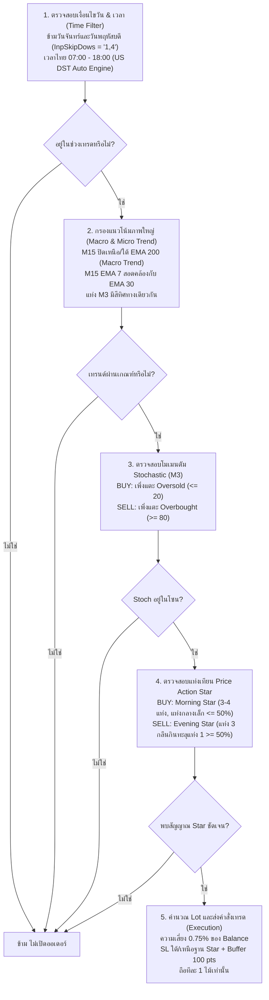

# SprintPA Q8 — Gold (XAUUSD) Price Action Expert Advisor
### 🏆 Automated Day-Trading System Optimized for Prop Firm Challenges (FTMO 2-Step & 1-Step)

[](https://www.metatrader5.com/)
[-gold.svg)]()
[]()
[]()
[-green.svg)]()
[-blueviolet.svg)]()

---

> 📌 **หมายเหตุสำคัญเกี่ยวกับ Repository นี้:**  
> Repository นี้เป็นคลังเก็บโค้ดฉบับสมบูรณ์ทางการ (**Standalone Production Release**) ของ **SprintPA Q8 No Thursday**  
> จัดทำขึ้นเพื่อให้ผู้ใช้งานสามารถดาวน์โหลด นำไปศึกษา และใช้งานสอบกองทุนได้ทันที โดยจะคงเวอร์ชันที่ผ่านการทดสอบและสอบทานทางคณิตศาสตร์อย่างเป็นทางการนี้ไว้ (**ไม่มีการเขียนทับอัตโนมัติตามรอบอัปเดตประจำวันของพอร์ตฟาร์ม**)

---

## สารบัญ (Table of Contents)
1. [ภาพรวมและปรัชญาของระบบ (Overview & Philosophy)](#1-ภาพรวมและปรัชญาของระบบ-overview--philosophy)
2. [สถาปัตยกรรมและกลไกการทำงาน (How It Works)](#2-สถาปัตยกรรมและกลไกการทำงาน-how-it-works)
3. [ผลการทดสอบ Backtest บนข้อมูล FTMO จริง (Backtest Results)](#3-ผลการทดสอบ-backtest-บนข้อมูล-ftmo-จริง-backtest-results)
   - [ผลการทดสอบย้อนหลัง 4 ปีเต็ม (Every Tick 48 เดือน)](#31-ผลการทดสอบย้อนหลัง-4-ปีเต็ม-พย-2022---ตค-2026-ทุน-10000)
   - [ตารางเปรียบเทียบผลงานรายปี (Yearly Breakdown)](#32-ตารางเปรียบเทียบผลงานรายปี-yearly-breakdown)
   - [ตารางผลงานรายเดือนครบทั้ง 48 เดือน (Monthly Breakdown)](#33-ตารางผลงานรายเดือนครบทั้ง-48-เดือน-monthly-breakdown)
   - [การจำลองสอบ FTMO 2-Step Phase 1 (Monte Carlo Rolling Test)](#34-การจำลองสอบ-ftmo-2-step-phase-1-rolling-test)
   - [ข้อสังเกตและการทดสอบระยะยาว 10 ปี (2016 - 2026)](#35-ข้อสังเกตและการทดสอบระยะยาว-10-ปี-2016---2026)
4. [ตารางเปรียบเทียบเวอร์ชัน: Q8 No Thursday vs Q8 Standard vs Q7](#4-ตารางเปรียบเทียบเวอร์ชัน-q8-no-thu-vs-q8-vs-q7)
5. [การตั้งค่าพารามิเตอร์และ Preset ที่แนะนำ (Recommended Settings)](#5-การตั้งค่าพารามิเตอร์และ-preset-ที่แนะนำ-recommended-settings)
6. [ขั้นตอนการติดตั้งและเริ่มใช้งาน (Installation Guide)](#6-ขั้นตอนการติดตั้งและเริ่มใช้งาน-installation-guide)
7. [โครงสร้างไฟล์ภายใน Repository](#7-โครงสร้างไฟล์ภายใน-repository)
8. [ข้อสงวนสิทธิ์และความเสี่ยง (Risk Disclaimer)](#8-ข้อสงวนสิทธิ์และความเสี่ยง-risk-disclaimer)

---

## 1. ภาพรวมและปรัชญาของระบบ (Overview & Philosophy)

**SprintPA Q8** คือ Expert Advisor (EA) สำหรับโปรแกรม **MetaTrader 5 (MT5)** พัฒนาขึ้นโดยเน้นกลยุทธ์ **Price Action Scalping / Day Trading** บนคู่เงินทองคำ (**`XAUUSD`**) บนไทม์เฟรม **`M3`** โดยเฉพาะ

### ปรัชญาการออกแบบเพื่อความอยู่รอดในการสอบกองทุน (Prop Firm Survival):
* **No Martingale / No Grid:** ไม่มีการเบิ้ลไม้, ไม่มีการเปิดตารางดอย, ไม่มีการแก้ไม้แบบ Hedging
* **Strict 1-Position Rule:** ถือสถานะออเดอร์ทีละ 1 ไม้เท่านั้น (`InpOnePositionOnly = true`) ไม่ถือซ้อน
* **Predetermined Risk & Reward:** ทุกออเดอร์มี Stop Loss (SL) และ Take Profit (TP) ชัดเจนตั้งแต่จังหวะเปิดไม้ (SL 1,000 points / TP 1,000 points หรือตามโครงสร้างแท่งเทียน Star)
* **Intraday Clean Exit:** ปิดจบในวัน ไม่ถือข้ามสุดสัปดาห์ ลดภาระค่า Swap และลดความเสี่ยงจากข่าวสงครามหรือ Weekend Gap
* **Hard Daily Loss Circuit Breaker:** ระบบตัดขาดทุนรายวันอัตโนมัติที่ **4.0%** ล็อกพอร์ตไม่ให้แตะเพดานขาดทุน 5.0% ของกฎ FTMO

---

## 2. สถาปัตยกรรมและกลไกการทำงาน (How It Works)

การออกออเดอร์ของ SprintPA Q8 เกิดจากการสอดประสานกันของ 5 กลไกหลัก:



### 2.1 ระบบแท่งเทียน Price Action (Morning Star & Evening Star)
* เข้าเทรดด้วยชุดแท่งเทียนกลับตัว **Morning Star** (สำหรับฝั่ง BUY) และ **Evening Star** (สำหรับฝั่ง SELL)
* โครงสร้าง 3-4 แท่ง: แท่งที่ 1 มีโมเมนตัม, แท่งที่ 2 (แท่งกลาง) เป็นแท่งพักตัวหรือไส้ยาวที่มีเนื้อเทียนขนาดเล็กไม่เกิน 50% ของแท่งแรก, และแท่งที่ 3 วิ่งย้อนกลับมากลืนกินเนื้อเทียนแท่งแรกอย่างน้อย 50% (`InpStarPenetration = 50.0%`)
* วาง Stop Loss อัตโนมัติไว้ใต้จุดต่ำสุด (BUY) หรือเหนือจุดสูงสุด (SELL) ของชุดแท่งเทียน Star พร้อมระยะเผื่อ Buffer 100 จุด (`InpSLUnderStar = true`) ทำให้ความเสี่ยงถูกควบคุมไว้ตามโครงสร้างกราฟจริง

### 2.2 ระบบกรองเทรนด์หลายไทม์เฟรม (Multi-Timeframe Trend Filter)
* **Macro Trend Filter:** ตรวจสอบแท่งปิดบนไทม์เฟรม `M15` เทียบกับเส้น `EMA 200` (`InpMacro200 = true`) หากราคาปิดอยู่เหนือ EMA 200 จะเปิดเฉพาะไม้ BUY เท่านั้น หากอยู่ใต้เส้นจะเปิดเฉพาะไม้ SELL
* **Micro Trend Filter:** ใช้เส้น `EMA 7` และ `EMA 30` บนไทม์เฟรม `M15` เพื่อยืนยันความแข็งแกร่งของทิศทางระยะสั้น
* **Candle Direction Alignment:** แท่งเทียน `M3` แท่งปิดล่าสุดต้องมีสีเขียว (BUY) หรือแดง (SELL) ตรงกับแนวโน้มของ `M15`

### 2.3 ตัวกรองโมเมนตัม Stochastic Oscillator
* ใช้ค่า `Stochastic (14, 3, 3)` บนไทม์เฟรม `M3`
* กรองไม่ให้เข้าเทรดไล่ราคา: ฝั่ง BUY ต้องมีประวัติแตะโซน Oversold (ต่ำกว่า 20) และฝั่ง SELL ต้องแตะโซน Overbought (สูงกว่า 80) ภายใน 3 แท่งก่อนหน้า

### 2.4 ระบบจัดการเวลาและการตัดวันพฤหัสบดี (Skip Thursday Engine — หัวใจของ Q8)
* **US DST Auto Timezone:** ระบบคำนวณการปรับเวลาตามฤดูกาลของสหรัฐฯ (Daylight Saving Time) โดยอัตโนมัติ เพื่อแปลงเวลาของเซิร์ฟเวอร์ FTMO (GMT+2 ในฤดูหนาว / GMT+3 ในฤดูร้อน) ให้ตรงกับเวลาไทย (GMT+7) อย่างแม่นยำ 100%
* **Trading Session:** กำหนดช่วงเวลาเทรดหลักใน **Session 1 (07:00 - 18:00 เวลาไทย)** ซึ่งเป็นช่วงที่สเปรดต่ำและมีแนวโน้มชัดเจนช่วงตลาดลอนดอน และหลีกเลี่ยงช่วงข่าวสหรัฐฯ ประกาศแรงช่วงหัวค่ำ
* **ตัดวันจันทร์และวันพฤหัสบดี (`InpSkipDows = "1,4"`):**
  * **วันจันทร์:** หลีกเลี่ยงความผันผวนจาก Gap เปิดตลาดและสภาพคล่องที่เพิ่งเริ่มต้น
  * **วันพฤหัสบดี (Thursday Discovery):** จากการวิเคราะห์ Big Data ย้อนหลังบนข้อมูล FTMO ตลอด 4 ปี พบว่าวันพฤหัสบดีเป็นวันที่ระบบเสียเงินมากที่สุดและมี Win Rate ต่ำที่สุดตลอดทั้งสองช่วงเวลา การตัดวันพฤหัสบดีออกส่งผลให้ **กำไรสุทธิเพิ่มขึ้นจาก +11.84% กลายเป็น +26.42% (เพิ่มขึ้น 2.2 เท่า)** โดยที่ Drawdown ลดลงต่ำกว่าเดิม

### 2.5 การยกเลิกการหยุดหลังแพ้ (Continuous Edge)
* ในรุ่นก่อนหน้า (Q7) ระบบถูกตั้งให้พัก 2 ชั่วโมงหลังแพ้ 1 ไม้ แต่ข้อมูลเชิงประจักษ์บน FTMO พบว่าสัญญาณ Star ที่เกิดตามหลังไม้มักเป็น Rebound ชนะรอบใหญ่ การตั้งค่า `InpStopAfterLosses = 0` ใน Q8 ช่วยให้ระบบเก็บกำไรต่อเนื่องได้เต็มประสิทธิภาพ

---

## 3. ผลการทดสอบ Backtest บนข้อมูล FTMO จริง (Backtest Results)

การทดสอบดำเนินการบนสภาพแวดล้อมจริงตามเกณฑ์มาตรฐานขั้นสูงสุดของ [AGENTS.md ข้อ 8](https://github.com/thatsayut/EA/blob/main/AGENTS.md):
* **โบรกเกอร์:** FTMO-Demo (`C:\Program Files\FTMO Global Markets MT5 Terminal`)
* **ข้อมูล:** Model 0 (Every tick based on real ticks ของ FTMO)
* **การตรวจยอด (Mathematical Audit):** ตรวจสอบยอดดีลทุกไม้ใน CSV ตรงกับ `final balance` ใน Strategy Tester 100% (ดูไฟล์ตรวจสอบได้ที่ [`backtest_reports/compare_audit.txt`](backtest_reports/compare_audit.txt))

### 3.1 ผลการทดสอบย้อนหลัง 4 ปีเต็ม (พ.ย. 2022 - ต.ค. 2026 ทุน $10,000)

| รายการสถิติ (Key Metrics) | ค่าที่ได้ (SprintPA Q8 No Thursday) | เกณฑ์กองทุน FTMO 2-Step | สถานะการผ่านเกณฑ์ |
|---|---|---|---|
| **ทุนตั้งต้น (Initial Deposit)** | **$10,000.00** | $10,000.00 | — |
| **กำไรสุทธิรวม (Net Profit)** | **+$2,642.02 (+26.42%)** | เป้าหมาย Phase 1 คือ +10% | ✅ ผ่านเป้าหมายกำไร |
| **จำนวนไม้เทรดทั้งหมด (Trades)** | **353 ไม้** (เฉลี่ย ~7.3 ไม้/เดือน) | — | เทรดแบบคัดเกรด A+ |
| **อัตราการชนะ (Win Rate)** | **50.7%** (ชนะ 179 / แพ้ 174) | — | มีกำไรสม่ำเสมอ |
| **Profit Factor (PF)** | **1.20** | > 1.00 | ✅ สภาพพอร์ตเติบโต |
| **Peak-to-Trough Drawdown** | **9.79%** | ห้ามเกิน 10.0% | ✅ ผ่านเกณฑ์ Max DD |
| **จุดต่ำสุดเทียบทุนตั้งต้น (Max Capital Dip)** | **7.26%** (เงินต่ำสุดคือ $9,274.00) | ต่ำกว่า $9,000 คือสอบตก | ✅ ปลอดภัยเหนือเพดาน 2.74% |
| **วันขาดทุนสูงสุด (Worst Single Day)** | **-1.88%** | ห้ามเกิน 5.0% ต่อวัน | ✅ ปลอดภัยกว่าเพดาน 2.6 เท่า |
| **จำนวนเดือนที่ติดลบ (Losing Months)** | **18 จาก 48 เดือน** (37.5%) | — | ชนะ 62.5% ของเดือนทั้งหมด |

---

### 3.2 ตารางเปรียบเทียบผลงานรายปี (Yearly Breakdown)

คำนวณกำไรขาดทุนแบ่งตามรอบปี (พ.ย. → ต.ค.) โดยเปรียบเทียบกับยอดเงินต้นปีนั้นๆ:

| รอบปีการทดสอบ | กำไร/ขาดทุน ($) | ผลตอบแทน (%) | จำนวนไม้ | Win Rate | Profit Factor | Peak DD | วันที่แย่ที่สุด |
|:---:|:---:|:---:|:---:|:---:|:---:|:---:|:---:|
| **ปี 2022 - 2023** | -$259.96 | **-2.60%** | 84 | 47.6% | 0.92 | 9.80% | -0.86% |
| **ปี 2023 - 2024** | +$557.00 | **+5.70%** | 69 | 53.6% | 1.24 | 4.70% | -1.44% |
| **ปี 2024 - 2025** | +$364.73 | **+3.50%** | 90 | 50.0% | 1.11 | 7.10% | -1.45% |
| **ปี 2025 - 2026** | +$1,980.25 | **+18.60%** | 110 | 51.8% | 1.44 | 3.40% | -1.88% |
| **รวม 4 ปีเต็ม** | **+$2,642.02** | **+26.42%** | **353** | **50.7%** | **1.20** | **9.79%** | **-1.88%** |

> *หมายเหตุ:* ปีที่ยากที่สุดสำหรับระบบเทรดทองคำคือรอบ 2022-2023 ซึ่งเป็นช่วงตลาดบีบตัวรุนแรง แต่ Q8 No Thursday ขาดทุนเพียง **-2.60%** เท่านั้น และสามารถทำกำไรต่อเนื่องได้ในอีก 3 ปีถัดมา

---

### 3.3 ตารางผลงานรายเดือนครบทั้ง 48 เดือน (Monthly Breakdown)

ดูข้อมูลฉบับเต็มและดาวน์โหลดประวัติออเดอร์ทั้ง 353 ไม้ได้ที่ [`backtest_reports/FTMO_4Year_EveryTick_Trades.csv`](backtest_reports/FTMO_4Year_EveryTick_Trades.csv)

| เดือน | กำไร/ขาดทุน ($) | ผลตอบแทน | ไม้เทรด | ชนะ / แพ้ | Win Rate |
|:---:|:---:|:---:|:---:|:---:|:---:|
| `2022-11` | +$70.06 | +0.70% | 7 | 4W / 3L | 57.1% |
| `2022-12` | -$231.06 | -2.31% | 9 | 3W / 6L | 33.3% |
| `2023-01` | -$5.00 | -0.05% | 12 | 6W / 6L | 50.0% |
| `2023-02` | -$70.16 | -0.70% | 1 | 0W / 1L | 0.0% |
| `2023-03` | +$104.90 | +1.05% | 9 | 5W / 4L | 55.6% |
| `2023-04` | +$134.90 | +1.35% | 6 | 4W / 2L | 66.7% |
| `2023-05` | -$360.78 | -3.61% | 9 | 2W / 7L | 22.2% |
| `2023-06` | -$289.04 | -2.89% | 6 | 1W / 5L | 16.7% |
| `2023-07` | -$45.02 | -0.45% | 6 | 3W / 3L | 50.0% |
| `2023-08` | +$115.10 | +1.15% | 6 | 4W / 2L | 66.7% |
| `2023-09` | +$130.08 | +1.30% | 6 | 4W / 2L | 66.7% |
| `2023-10` | +$194.10 | +1.94% | 7 | 4W / 3L | 57.1% |
| `2023-11` | +$201.06 | +2.01% | 7 | 5W / 2L | 71.4% |
| `2023-12` | -$145.04 | -1.45% | 4 | 1W / 3L | 25.0% |
| `2024-01` | +$139.92 | +1.40% | 4 | 3W / 1L | 75.0% |
| `2024-02` | +$159.00 | +1.59% | 4 | 3W / 1L | 75.0% |
| `2024-03` | -$83.08 | -0.83% | 5 | 2W / 3L | 40.0% |
| `2024-04` | +$176.96 | +1.77% | 2 | 2W / 0L | 100.0% |
| `2024-05` | +$187.08 | +1.87% | 11 | 6W / 5L | 54.5% |
| `2024-06` | +$52.02 | +0.52% | 5 | 3W / 2L | 60.0% |
| `2024-07` | +$104.94 | +1.05% | 7 | 4W / 3L | 57.1% |
| `2024-08` | -$78.96 | -0.79% | 7 | 3W / 4L | 42.9% |
| `2024-09` | +$5.02 | +0.05% | 7 | 3W / 4L | 42.9% |
| `2024-10` | -$152.00 | -1.52% | 6 | 2W / 4L | 33.3% |
| `2024-11` | +$336.88 | +3.37% | 10 | 7W / 3L | 70.0% |
| `2024-12` | -$585.12 | -5.85% | 10 | 1W / 9L | 10.0% |
| `2025-01` | +$252.04 | +2.52% | 7 | 5W / 2L | 71.4% |
| `2025-02` | +$101.06 | +1.01% | 5 | 3W / 2L | 60.0% |
| `2025-03` | -$71.02 | -0.71% | 5 | 2W / 3L | 40.0% |
| `2025-04` | -$108.06 | -1.08% | 8 | 3W / 5L | 37.5% |
| `2025-05` | +$64.08 | +0.64% | 7 | 4W / 3L | 57.1% |
| `2025-06` | -$251.04 | -2.51% | 8 | 2W / 6L | 25.0% |
| `2025-07` | +$483.92 | +4.84% | 10 | 8W / 2L | 80.0% |
| `2025-08` | +$308.10 | +3.08% | 5 | 4W / 1L | 80.0% |
| `2025-09` | -$326.16 | -3.26% | 8 | 2W / 6L | 25.0% |
| `2025-10` | +$179.14 | +1.79% | 7 | 4W / 3L | 57.1% |
| `2025-11` | +$536.86 | +5.37% | 12 | 8W / 4L | 66.7% |
| `2025-12` | -$1.98 | -0.02% | 7 | 3W / 4L | 42.9% |
| `2026-01` | +$364.96 | +3.65% | 8 | 5W / 3L | 62.5% |
| `2026-02` | -$55.02 | -0.55% | 3 | 1W / 2L | 33.3% |
| `2026-03` | +$41.04 | +0.41% | 4 | 2W / 2L | 50.0% |
| `2026-04` | -$83.04 | -0.83% | 3 | 1W / 2L | 33.3% |
| `2026-05` | +$63.12 | +0.63% | 13 | 6W / 7L | 46.2% |
| `2026-06` | +$240.10 | +2.40% | 12 | 6W / 6L | 50.0% |
| `2026-07` | +$128.94 | +1.29% | 15 | 7W / 8L | 46.7% |
| `2026-08` | +$11.02 | +0.11% | 10 | 4W / 6L | 40.0% |
| `2026-09` | +$424.06 | +4.24% | 9 | 6W / 3L | 66.7% |
| `2026-10` | +$352.12 | +3.52% | 14 | 8W / 6L | 57.1% |

---

### 3.4 การจำลองสอบ FTMO 2-Step Phase 1 (Rolling Test)

การจำลองสอบประเมินโดยเริ่มเปิดพอร์ตสอบใหม่ขนาด $10,000 ใน **ทุกๆ วันที่มีการเทรดตลอด 4 ปี** (เป้าหมายกำไร +10% หรือ $1,000 และตกทันทีเมื่อขาดทุนวันเดียว >= 5% หรือยอดเงินรวมเหลือ <= $9,000):

* **อัตราการสอบผ่าน (Pass Rate):** **92.9%**
* **อัตราการทำพอร์ตแตก / สอบตก (Breach Rate):** **0.0%** (ไม่เคยทำพอร์ตแตกแม้แต่วันเดียวใน 4 ปี)
* **พอร์ตที่ยังเทรดไม่จบรอบ (Open):** 7.1%
* **มัธยฐานของวันที่ใช้จนถึงเป้าหมาย (Median Days to Pass):** **315 วันทำการ**

---

### 3.5 ข้อสังเกตและการทดสอบระยะยาว 10 ปี (2016 - 2026)

เพื่อความโปร่งใสตามหลักการประเมินทางวิทยาศาสตร์ ทีมพัฒนาได้ทดสอบย้อนหลังครอบคลุม 10 ปี (พ.ย. 2016 – ต.ค. 2026) โดยมีข้อค้นพบสำคัญดังนี้:
1. **ข้อมูล FTMO ก่อนปี 2022:** โบรกเกอร์ FTMO ไม่มีข้อมูล Real Ticks ก่อนปี 2022 (Strategy Tester ใช้แท่ง M1 จำลองติ๊กขึ้นมา) รวมถึงเซิร์ฟเวอร์ในอดีตมีการเปลี่ยน Timezone ระหว่างปี 2021
2. **Market Regime Shift:** กลยุทธ์ Price Action Scalping ของ Q8 ถูกออกแบบมาสำหรับพฤติกรรมทองคำยุคใหม่ (ปี 2022–2026) ซึ่งมี Volume และความผันผวนสูง การรันย้อนหลังไปในยุคตลาดซบเซา (2017–2019) จะพบ Drawdown สูงถึง 35% ดังนั้น **ระบบนี้จึงแนะนำให้ใช้กับสภาพตลาดทองคำในปัจจุบันเป็นต้นไป**

---

## 4. ตารางเปรียบเทียบเวอร์ชัน: Q8 No Thu vs Q8 vs Q7

| พารามิเตอร์ / ผลงาน | SprintPA Q8 No Thu (แชมป์เปียน) | SprintPA Q8 Standard | SprintPA Q7 D3 |
|---|---|---|---|
| **วันเทรดที่ข้าม (Skip Days)** | **วันจันทร์ และ วันพฤหัสบดี (1,4)** | วันจันทร์ (1) | วันจันทร์ (1) |
| **ช่วงเวลาเทรด (Session)** | **07:00 - 18:00 (ไทย)** | 07:00-18:00 & 21:00-00:00 | 03:00-05:00 & 07:00-18:00 |
| **การหยุดหลังแพ้** | **ไม่หยุด (`InpStopAfterLosses=0`)** | ไม่หยุด | หยุดพัก 40 แท่ง (2 ชม.) |
| **กำไรสุทธิ 4 ปี** | **+$2,642.02 (+26.42%)** | +$1,184.10 (+11.84%) | +$406.47 (+4.06%) |
| **Max Drawdown 4 ปี** | **9.79%** | 9.93% | 11.73% |
| **Win Rate** | **50.7%** | 48.4% | 47.7% |
| **Profit Factor** | **1.20** | 1.07 | 1.02 |
| **อัตราผ่าน FTMO 2-Step** | **92.9%** | 77.5% | 71.0% |

---

## 5. การตั้งค่าพารามิเตอร์และ Preset ที่แนะนำ (Recommended Settings)

ภายในโฟลเดอร์ [`presets/`](presets/) ได้จัดเตรียมชุดไฟล์ตั้งค่าที่ผ่านการปรับจูนมาแล้ว:

### 1. สำหรับสอบ FTMO 2-Step Challenge (ทุน $10,000) — *แนะนำที่สุด*
* ไฟล์ Preset: [`presets/FTMO_2Step_Challenge_Risk0.75.set`](presets/FTMO_2Step_Challenge_Risk0.75.set)
* **`InpRiskPercent` = `0.75%`** (Sweet Spot ควบคุม Max DD ไม่เกิน 9.79% ปลอดภัยกว่าเพดาน 10.0%)
* **`InpMaxDailyLossPct` = `4.0%`** (ป้องกันไม่ให้ชนเพดาน Daily Loss 5.0%)
* **`InpSkipDows` = `"1,4"`** (ไม่เทรดวันจันทร์และพฤหัสบดี)

### 2. สำหรับสอบ FTMO 1-Step Challenge (ทุน $10,000)
* ไฟล์ Preset: [`presets/FTMO_1Step_Challenge_Risk0.50.set`](presets/FTMO_1Step_Challenge_Risk0.50.set)
* **`InpRiskPercent` = `0.50%`** (ลดขนาดความเสี่ยงเพื่อให้อยู่ในกรอบ Max DD 6.0%)
* **`InpMaxDailyLossPct` = `2.5%`** (ป้องกันเพดาน Daily Loss 3.0% ของโหมด 1-Step)

### 3. สำหรับพอร์ตส่วนตัว (High Growth Mode)
* ไฟล์ Preset: [`presets/HighGrowth_Aggressive_Risk1.00.set`](presets/HighGrowth_Aggressive_Risk1.00.set)
* **`InpRiskPercent` = `1.00%`**
* **`InpMaxDailyLossPct` = `5.0%`**

---

## 6. ขั้นตอนการติดตั้งและเริ่มใช้งาน (Installation Guide)

1. **คัดลอกไฟล์ EA:**
   * นำไฟล์ `SprintPA_Q8_NoThu.mq5` (หรือไฟล์คอมไพล์สำเร็จ `SprintPA_Q8_NoThu.ex5`) ไปวางไว้ในโฟลเดอร์:
     ```
     <โฟลเดอร์ข้อมูล MT5>\MQL5\Experts\
     ```
   *(เข้าได้จากเมนู MT5: File -> Open Data Folder -> MQL5 -> Experts)*
2. **คอมไพล์โค้ด (หากใช้ไฟล์ `.mq5`):**
   * เปิด **MetaEditor** (กด `F4` บน MT5) ดับเบิลคลิกเปิดไฟล์ `SprintPA_Q8_NoThu.mq5` แล้วกด **Compile** (`F7`) ให้ได้ 0 Errors
3. **เปิดกราฟและตั้งค่าไทม์เฟรม:**
   * เปิดกราฟคู่เงิน **`XAUUSD`** (Gold)
   * เปลี่ยนไทม์เฟรมเป็น **`M3`** (3 นาที) *[หากไม่มี M3 ให้คลิกขวาที่แถบไทม์เฟรม -> Timeframes -> Minutes -> 3 Minutes]*
4. **ลาก EA ลงบนกราฟ:**
   * ลาก `SprintPA_Q8_NoThu` ลงบนกราฟ
   * ในแท็บ **Common** ติ๊กถูกที่ช่อง **"Allow Algo Trading"**
   * ในแท็บ **Inputs** กดปุ่ม **Load** แล้วเลือกไฟล์ Preset เช่น `presets/FTMO_2Step_Challenge_Risk0.75.set`
   * กด **OK**
5. **เปิดระบบเทรดอัตโนมัติ:**
   * กดปุ่ม **Algo Trading** ด้านบนของโปรแกรม MT5 ให้เป็นสีเขียว สังเกตมุมขวาบนของกราฟจะมีไอคอนหมวกสีน้ำเงินแสดงว่า EA กำลังทำงาน

---

## 7. โครงสร้างไฟล์ภายใน Repository

```
SprintPA_Q8/
├── README.md                                # เอกสารคู่มือฉบับสมบูรณ์ (ไฟล์นี้)
├── SprintPA_Q8_NoThu.mq5                    # ซอร์สโค้ด MQL5 แชมป์เปียน (ข้ามวันจันทร์และพฤหัสบดี)
├── SprintPA_Q8_NoThu.ex5                    # ไบนารีคอมไพล์สำเร็จพร้อมใช้งาน
├── SprintPA_Q8.mq5                          # ซอร์สโค้ด MQL5 รุ่น Q8 มาตรฐาน (ข้ามวันจันทร์อย่างเดียว)
├── SprintPA_Q8.ex5                          # ไบนารีคอมไพล์สำเร็จรุ่นมาตรฐาน
├── presets/
│   ├── FTMO_2Step_Challenge_Risk0.75.set    # ค่าคอนฟิกแนะนำสำหรับสอบ FTMO 2-Step ($10k ทุน)
│   ├── FTMO_1Step_Challenge_Risk0.50.set    # ค่าคอนฟิกแนะนำสำหรับสอบ FTMO 1-Step
│   └── HighGrowth_Aggressive_Risk1.00.set   # ค่าคอนฟิกสำหรับพอร์ตส่วนตัวเน้นปั้นพอร์ต
├── backtest_reports/
│   ├── FTMO_4Year_EveryTick_Trades.csv      # ประวัติการปิดออเดอร์ทั้ง 353 ไม้จากการทดสอบ FTMO Every Tick
│   ├── FTMO_4Year_Performance_Summary.md    # สรุปผลการทดสอบเชิงลึกรายเดือนและรายปี
│   └── compare_audit.txt                   # เอกสารยืนยันผลการตรวจยอดตัวเลขตรงกับ Tester 100%
└── .gitignore                               # ตัวกรองไฟล์ Git
```

---

## 8. ข้อสงวนสิทธิ์และความเสี่ยง (Risk Disclaimer)

* การเทรด Forex, สัญญาส่วนต่าง (CFDs) และทองคำ (XAUUSD) มีความเสี่ยงสูง อาจทำให้สูญเสียเงินลงทุนทั้งหมดได้
* ผลการทดสอบย้อนหลัง (Backtest) เป็นการประเมินตามข้อมูลสถิติในอดีต ไม่ได้รับประกันผลตอบแทนในอนาคต
* ผู้ใช้งานควรทดสอบบนบัญชีทดลอง (Demo Account) ก่อนนำไปใช้สอบกองทุนหรือเทรดในบัญชีเงินจริงเสมอ
* ผู้พัฒนาไม่มีส่วนรับผิดชอบต่อความสูญเสียหรือความเสียหายใดๆ ที่เกิดจากการนำระบบนี้ไปใช้งาน

---

**Developed with Precision & Rigorous Quantitative Verification**  
*Maintained by: [@thatsayut](https://github.com/thatsayut)*
